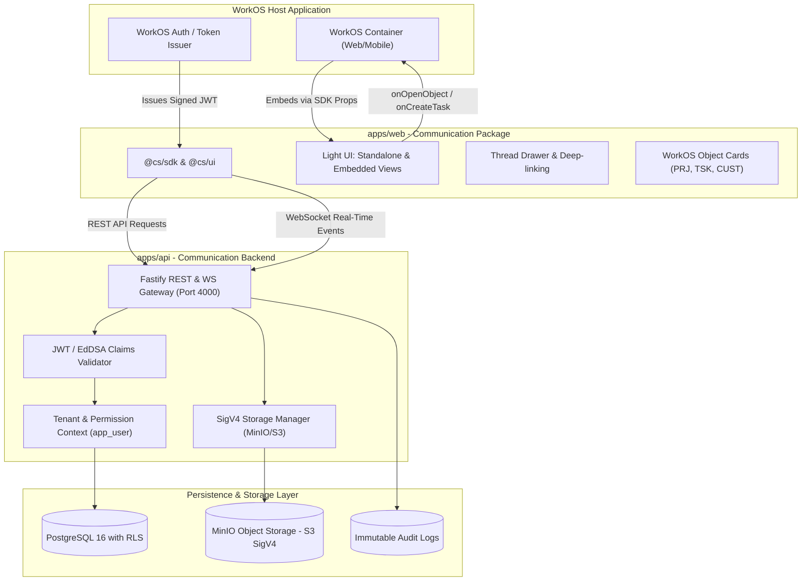

# WorkOS Internal Communication System

> **A secure, standalone, multi-tenant internal communication system built for seamless embedding into WorkOS.**  
> Developed as an independent product with its own backend, database, and frontend package without requiring access to WorkOS source code, database, or production environment.

---

## 🌟 Highlights & Visual Design

- **Humanized, Original Light-Themed UI**: Crisp white and soft neutral workspaces (`#ffffff`, `#f8fafc`), deep navy top bar (`#0a1a36`), sleek dark navy sidebar (`#0b1329`), and rich blue accents (`#2563eb`), matching the production WorkOS visual specifications.
- **Standalone App & Embedded Host View**: Toggle seamlessly between Standalone mode and Embedded Host View with WorkOS object drawers (`PRJ-109`, `TSK-401`, `CUST-88`) and task creation modals (`onCreateTask`).
- **One-Click Synthetic Personas**: Immediate sign-in as **Vedant Kulkarni** (Engineering Lead), **Rohan Deshmukh** (Full Stack), **Sneha Patil** (Product Designer), or **Alex (Cyberdyne Systems)** for cross-company multi-tenant testing.
- **Section 11 Acceptance Demonstration Suite**: Built-in 8-step interactive suite in the top bar with live execution and automated assertions.
- **OpenAPI 3.1 & Contracts Viewer**: 31 registered REST endpoints, WebSocket schema, and full RBAC matrix inspectable in-app.
- **Real-Time Delivery & Threads**: Deep-linking URL hash (`#/c/:conversationId/t/:threadId`), live thread drawer, unread counters, delivery receipts (`✓✓`), and reactions.
- **Direct-to-Storage Attachments**: SigV4 presigned upload and download flows with genuine PDF preview, pin-to-channel, and instant file download.
- **Tenant Isolation & Security**: PostgreSQL Row-Level Security enforced via dedicated non-superuser role (`app_user`), preventing cross-tenant leakage.

---

## 🏗 System Architecture



---

## 🚀 Quick Start

### Option A: Local Development (Instant Browser Preview)

```bash
# 1. Clone repository and navigate to root
cd Work-os

# 2. Install dependencies
pnpm install

# 3. Start Frontend (Vite Dev Server)
pnpm --filter @cs/web dev
# Access the web app at: http://localhost:5173

# 4. Start Backend API
pnpm --filter @cs/api dev
# API listening at: http://localhost:4000

# 5. Start Mock IdP (Optional for custom token generation)
pnpm --filter @cs/mock-idp dev
# Mock IdP listening at: http://localhost:4001
```

### Option B: Full Docker Stack (PostgreSQL, MinIO, API, Web, Mock IdP)

```bash
# Start all containers in isolated network
docker compose -f infra/docker-compose.yml up --build

# Run database migrations and seed synthetic tenants
pnpm --filter @cs/api db:migrate
pnpm --filter @cs/api db:seed
```

---

## 👤 Synthetic Personas & Multi-Tenant Testing

The application provides pre-configured synthetic personas across two tenant organizations:

| Persona | Organization | Role | Allowed Permissions | Key Capabilities |
| :--- | :--- | :--- | :--- | :--- |
| **Vedant Kulkarni** | Acme Corp | Owner / Lead | All 9 Permissions | Manage channels, moderate, audit logs, publish announcements |
| **Rohan Deshmukh** | Acme Corp | Senior Member | 5 Member Permissions | Send messages, participate in channels, upload files, react |
| **Sneha Patil** | Acme Corp | Designer / Member | 5 Member Permissions | Create threads, reply, link WorkOS design tasks |
| **Alex** | Cyberdyne Systems | External Tenant | Separate Tenant Sandbox | Completely isolated tenant; zero visibility into Acme Corp data |

---

## 🧪 Testing & Verification

### 1. Automated Vitest Unit & Compliance Test Suite
All 33 unit and compliance test suites pass cleanly:
```bash
pnpm --filter @cs/api test
```
- `src/__tests__/unit/rbac-matrix.test.ts` (13 tests): Asserts all 9 RBAC permissions and strict tenant boundaries.
- `src/__tests__/unit/acceptance-suite.test.ts` (8 tests): Asserts all 8 steps of the Section 11 Acceptance Demonstration.
- `src/__tests__/unit/db-role.test.ts` (5 tests): Enforces that `app_user` is strictly non-superuser and non-bypassrls.
- `src/__tests__/unit/policy.test.ts` (7 tests): Verifies message moderation and channel policies.

### 2. Interactive Acceptance Demonstration Suite
1. Open `http://localhost:5173`.
2. Click the green **`[ Acceptance Suite ]`** button in the top navigation bar.
3. Click **"Run Full Acceptance Suite"** to execute all 8 steps live with verified indicators:
   - **Step 1**: Standalone & Embedded Host Integration
   - **Step 2**: Persona Switch & Claims-Based RBAC
   - **Step 3**: Channel Creation & Access Controls
   - **Step 4**: Real-time Messaging, Mentions & Reactions
   - **Step 5**: Threads & Deep-linking URL Hashes
   - **Step 6**: Direct-to-Storage Presigned Uploads & Pinning
   - **Step 7**: Cross-Tenant Isolation Enforcement
   - **Step 8**: Channel Archive & Immutable Audit Trail

### 3. Postman & OpenAPI 3.1 Testing
- Import `docs/openapi.json` into Postman or use the collections in `postman/`.
- 31 registered REST endpoints covering:
  - Auth / Token exchange (`/v1/auth/*`)
  - Channels (`/v1/channels`, `/v1/channels/:id/archive`, `/v1/channels/:id/unarchive`)
  - Messages & Threads (`/v1/channels/:id/messages`, `/v1/messages/:id/thread`)
  - Reactions (`/v1/messages/:id/reactions`)
  - Attachments (`/v1/attachments/presign-upload`, `/v1/attachments/:id/presign-download`)
  - Search (`/v1/search`)
  - Audit Logs (`/v1/audit`)
  - Webhooks (`/v1/webhooks`)

---

## 🔒 Security & Tenant Isolation

- **PostgreSQL Row-Level Security (RLS)**: Enforced through `current_setting('app.current_company_id', true)` and `current_setting('app.current_user_id', true)`.
- **Database Privilege Hardening**: Backend connects using `app_user` (`NOSUPERUSER`, `NOBYPASSRLS`), preventing accidental bypassing of RLS policies.
- **SigV4 Presigned Uploads**: Files are uploaded directly from the client to MinIO/S3 using presigned URLs with strict MIME-type and size limits (25MB max).
- **Audit Logging**: All administrative actions (channel creation, member changes, archive/unarchive, deletions) emit immutable audit events with actor ID, IP address, and timestamp.

---

## 📦 Project Structure

```
Work-os/
├── apps/
│   ├── web/               # Humanized light UI, React 18, Vite, TailwindCSS
│   ├── api/               # Fastify, WebSocket, SigV4 storage, PostgreSQL RLS
│   └── mock-idp/          # Mock identity provider issuing test JWTs
├── packages/
│   ├── contracts/         # TypeScript types, claims, permissions, OpenAPI
│   ├── sdk/               # Embeddable WorkOS communication client
│   ├── ui/                # Shared UI primitives
│   └── test-fixtures/     # Synthetic personas and token fixtures
├── docs/
│   ├── openapi.json       # OpenAPI 3.1 specification (31 paths)
│   ├── IMPLEMENTATION_AUDIT.md # 42-item audit across Sections 1-13
│   ├── HANDOFF.md         # Production engineering handoff notes
│   ├── ARCHITECTURE.md    # Detailed subsystem architecture
│   └── RBAC.md            # Permission matrix & role definitions
└── infra/
    ├── docker-compose.yml # Containerized stack
    └── postgres/          # Schema migrations & RLS policies
```

---

## 📄 License & Attribution
Proprietary & Confidential. Designed for the WorkOS Internal Communication System integration.
